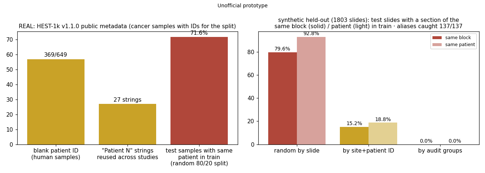

# Spatial dataset release check

> Unofficial prototype by Kushagra Pratap Singh. Not affiliated with Origin Bio.

## The problem
[Origin](https://origin.bio/) gets FFPE tumor blocks "from hospital and biobank partners". Those blocks are "sectioned and captured on slides", and the result is matched spatial transcriptomics + H&E + clinical labels, used to "predict spatial gene expression" from morphology and to predict drug response. When a dataset like that is licensed, the buyer's first question is whether their held-out patients will reproduce your numbers.

That depends on IDs and splits:
- One block can arrive through two partners under two patient IDs.
- Serial sections of one block are near-copies of each other.
- Partner IDs restart at "P001".

Any split that misses these puts the same tissue in train and test.

**Real public data shows the field is not enough.** In HEST-1k v1.1.0's public metadata ([mahmoodlab/HEST](https://github.com/mahmoodlab/HEST), `assets/HEST_v1_1_0.csv`, metadata only):
- **369 of 649** human samples have a blank `patient` field.
- Among cancer samples with an ID, **172 belong to 50 patients** with more than one sample.
- **27 patient strings** (like "Patient 1") are each reused across different studies. Grouping by the string alone merges different people (13 cases in the cancer subset).
- A random 80/20 split by sample puts the **same patient in train for 71.6% of test samples**.

HEST-Benchmark itself uses patient-level folds; the point is that the metadata field alone doesn't give you one. Run `python hest_audit.py` to reproduce these numbers.

## What I built
`stcheck/audit.py` takes per-slide metadata (slide, site, patient, label), spot H&E features and spot expression on the same grid:
1. **Patient-field audit:** blank IDs, IDs reused across sites (so it keys on site + patient), and multi-section patients.
2. **Hidden serial sections:** for each slide, a spot-expression map on shared PCs (with the slide mean removed, so site batch and patient offset drop out), lightly smoothed. Every pair is compared with an **exact Pearson correlation at each shift up to ±4 spots** (one matmul per shift). A link needs correlation ≥ 0.72 and both slides ranking each other in their top 4.
3. **Split groups:** union-find over site + patient keys and the found links, then a grouped train/test split.
4. **Confounding:** site × responder (one row per group) with Cramér's V and a permutation p, plus how often the site can be read off H&E features.
5. **Exposure:** for any split, the share of test slides that have a section of the same block or patient in train. This needs no model.

`evaluate.py` also trains a kNN morphology → expression baseline. It's scored HEST-style (per-gene Pearson within each test slide) on each split's own test set and on brand-new patients.

## Results: held-out, first run, no changes after it
There are 10 synthetic worlds (each a cohort plus a fresh-patient cohort; every other one with a planted site–responder skew), with seeds committed to git ([`heldout/seeds.json`](heldout/seeds.json), commit `10ffaa0`) before the first run. Dev used worlds 0–9.



| 1,803 slides, 137 planted alias sections | Random by slide | By site + patient ID | **By audit groups** |
|---|---|---|---|
| Test slides with a section of the same block in train | 79.6% | 15.2% | **0.0%** |
| ... with the same patient in train | 92.8% | 18.8% | **0.0%** |

- **Aliases** (extra sections of a block filed under a new ID by another partner): **137 of 137** found. **8 slides** were wrongly merged with another patient's group. That only makes the split coarser; it doesn't leak. The demo shows one: two different "P001"s from different sites whose maps correlated at 0.78.
- **Confounding:** the flag fired on 3 of 5 cohorts with a planted skew, and on 1 of 5 without. With about 50 patients over 4 sites, a moderate skew is hard to prove, so the report gives the table, not just the flag. H&E features identify the site for 98% of slides (chance 25%), which is why a site held out of evaluation matters.
- **Model optimism was small in this generator.** A kNN on stain-centred features scored only up to 0.014 r higher on leaky splits than on fresh patients. That is because most of the morphology → expression mapping here is shared across patients. I tried several generator versions while building and didn't tune one until leakage looked big. The exposure numbers above are the model-free result; how much exposure inflates a real model depends on the model and the tissue.

## Run it
```bash
pip install numpy scipy matplotlib pytest
python demo.py                 # one cohort: ID audit, found aliases, exposure by split, confounding (~10 s)
python hest_audit.py           # real HEST-1k metadata (or: curl the CSV, then python hest_audit.py HEST_v1_1_0.csv)
```
`python evaluate.py heldout` takes ~12 min. `python -m pytest -q tests` runs 6 tests.

## Honest limits
- The cohorts are synthetic: features stand in for H&E foundation-model embeddings, and there are no images, segmentation or H&E↔ST registration. Real serial sections deform and lose tissue, so the threshold of 0.72 would need setting on real pairs.
- Sections from *different* blocks of the same patient are not linked: a profile-similarity test overlapped too much with unrelated patients to use.
- The real HEST audit uses metadata only. I didn't check whether any HEST samples are physical duplicates.
